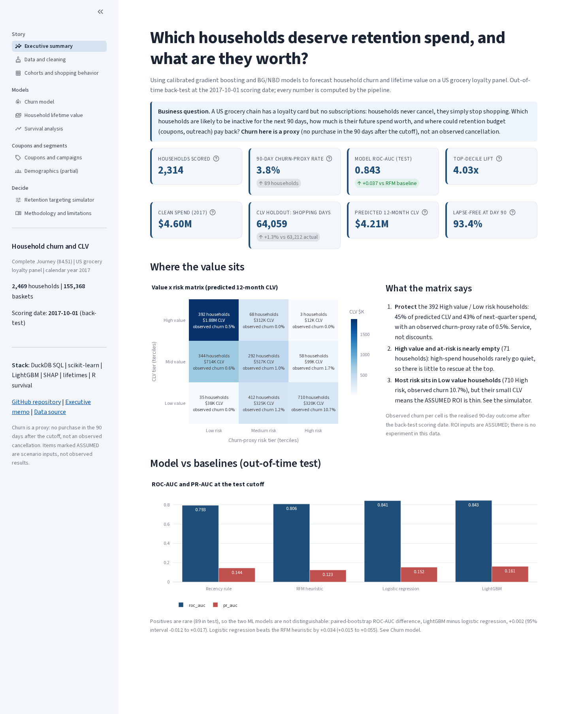
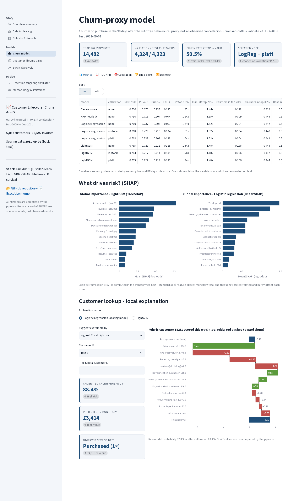
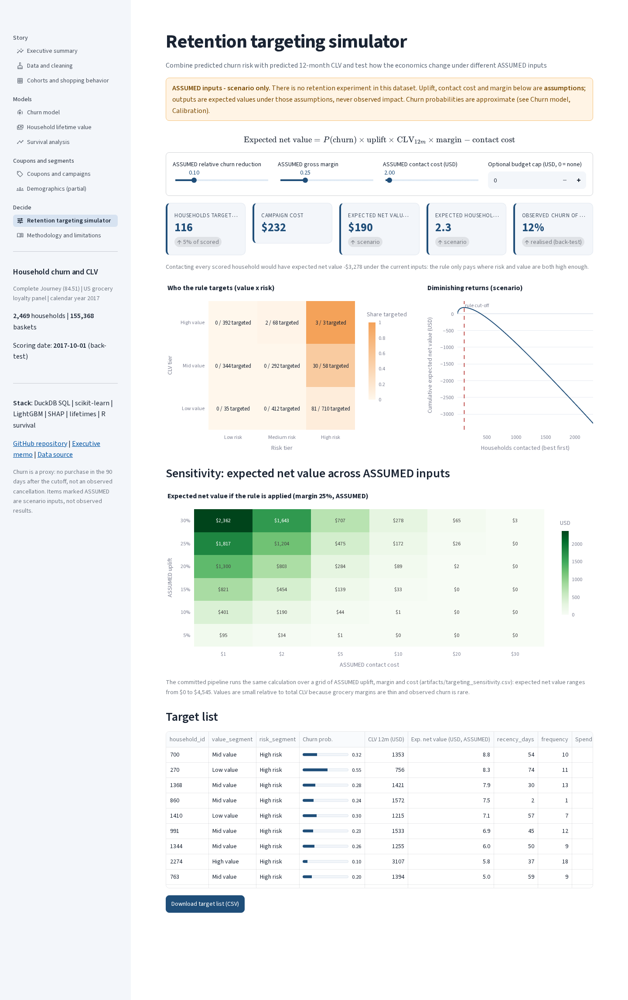
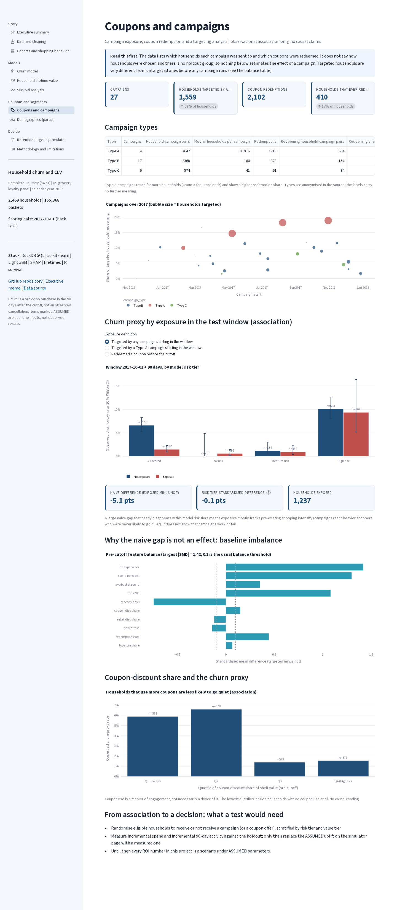

# Grocery Household Churn & CLV - Using calibrated gradient boosting and BG/NBD models to forecast household churn and lifetime value on a US grocery loyalty panel

> **Outcome:** a reproducible pipeline that ranks 2,314 active grocery households by 90-day churn-proxy risk
> (out-of-time ROC-AUC 0.843, top-decile lift 4.03x, with only 89 test positives so intervals are wide) and by
> predicted 12-month value (BG/NBD + Gamma-Gamma forecast holdout shopping days within 1.3%), and turns both
> into a value x risk targeting rule whose economics are shown as an explicit, **ASSUMED**-parameter scenario,
> not a promised impact. **Churn here is a proxy** (no purchase in the 90 days after a cutoff), not an observed
> cancellation.

[](https://github.com/Abhi237/customer-churn-clv/actions/workflows/ci.yml)
· SQL (DuckDB) · Python (scikit-learn, LightGBM, SHAP, lifetimes) · R (survival, survminer, Quarto)

| | |
|---|---|
|  |  |
|  |  |

**Deliverables:** [executive memo (PDF)](docs/retention_memo.pdf) · [memo (md)](docs/retention_memo.md) ·
[survival report (HTML)](reports/survival_report.html) · [EDA notebook](notebooks/01_eda.ipynb) ·
[model notebook](notebooks/02_model_walkthrough.ipynb) · [data dictionary](docs/data_dictionary.md) ·
[data model](docs/data_model.md) · [architecture](docs/architecture.md) · [data notes](data/README.md)

## Interactive app
A multipage Streamlit app (`app/streamlit_app.py`, light theme) presents the project for stakeholders. It reads
**only** compact aggregated artifacts committed in `app/data/` (about 1.1 MB: summaries, curves, cohort and
survival tables and the 2,314 scored households with features, probabilities, CLV, segments and precomputed
SHAP values). No raw transactions, pipeline or ML libraries are needed at deploy time. The hosted app is
deployed from `main`; it shows this grocery version once this branch is merged.

**Audience.** The app is written for a **retention marketing manager** deciding where next quarter's retention budget
goes. The Executive summary opens with headline KPIs (households scored, churn-proxy rate, CLV at risk, expected
net value at the ASSUMED defaults) and numbered recommendations, each with a one-line reason and a link to the page
that supports it. Every page starts with the question it answers and a one-line "so what".

| Page | What it shows |
|---|---|
| Executive summary | business question, headline KPI cards, numbered recommendations with links, value x risk matrix |
| Data and cleaning | pipeline graph, cleaning waterfall, data-quality checks |
| Cohorts and shopping behavior | retention heatmap, rolling activity, department mix, RFM |
| Churn model | metrics vs baselines with CIs, ROC/PR, calibration, lift, backtest, SHAP and household lookup |
| Household lifetime value | BG/NBD + Gamma-Gamma holdout validation, CLV distribution and concentration |
| Survival analysis | Kaplan-Meier by segment, Cox hazard ratios, `cox.zph` checks (computed in R) |
| Coupons and campaigns | exposure and redemption, balance checks, observational association (no causal claim) |
| Demographics (partial) | breakout for the 801 households with demographics, with coverage flagged |
| Retention targeting simulator | sliders for **ASSUMED** uplift, margin and cost with live ROI, sensitivity grid, target list |
| Methodology and limitations | validation design, leakage controls, proxy-label and calibration caveats |

```bash
make app-data        # refresh app/data/ from pipeline outputs
make app             # http://localhost:8501
```
**Deploy on Streamlit Community Cloud:** main file `app/streamlit_app.py`, Python 3.11; dependencies from
`app/requirements.txt` (streamlit, pandas, numpy, pyarrow, plotly). Theme: `.streamlit/config.toml`.

| | |
|---|---|
|  |  |
|  |  |

All ten page screenshots: [`docs/app_screenshots/`](docs/app_screenshots/).

---

## 1. Situation and question
A US grocery chain runs a loyalty card but no subscriptions, so households never "cancel": they simply stop
shopping. Commercial leadership asks:

> **Which active households should receive retention spend (coupons, outreach), and how much might their future
> shopping be worth?**

Three lenses answer it: a **churn-proxy classifier** (who is likely to be inactive over the next 90 days), a
**probabilistic CLV model** (what their future spend is worth), and **survival analysis** (how long households
stay active and what early behavior predicts it). A coupon/campaign analysis and a partial-coverage demographics
breakout add context.

## 2. Data
| | |
|---|---|
| Source | 84.51 **Complete Journey 2.0** study data as redistributed by the R package [`completejourney`](https://github.com/bradleyboehmke/completejourney) v1.1.1 (**CC0 1.0**, public domain dedication). See [data/README.md](data/README.md) |
| Period | calendar year 2017 (2017-01-01 to 2017-12-31) |
| Raw size | 1,469,307 transaction lines, 155,848 baskets, 2,469 loyalty-card households, 457 stores, 92,331 products |
| Clean grain | `fct_baskets`: one row per household x basket. **155,368 baskets, $4.60M spend, 127,320 shopping days** |
| Mix | top 10% of households = 35.0% of spend; store discounts are 14.7% of shelf value, coupon discounts 0.57%; 6.3% of baskets use a coupon |
| Campaigns | 27 campaigns (Types A, B, C) targeting 1,559 households; 2,102 redemptions by 410 households |
| Demographics | only **801 of 2,469 households (32%)** (partial coverage; those households are heavier shoppers) |

Only loyalty-card purchases are observed (card-less shoppers are invisible), for one retailer and one year.

**Cleaning decisions** (`sql/02`, `sql/03`; every count is in `dq_report` and `dq_cleaning_waterfall`):

| Issue | Raw lines | Decision |
|---|---|---|
| Empty lines (no sales value, no discount) | 5,859 | dropped |
| Zero quantity with positive sales | 29 | dropped (not interpretable as units) |
| Zero price, no discount | 263 | dropped |
| Free-item lines ($0 sales but discounted) | 2,143 | kept (real redemptions) |
| Coupon-only lines | 2,981 | kept |
| Quantity above 1,000 (13,494 lines, 11,818 of them fuel) | 13,494 | units set to NULL, dollars kept |
| Lines above $500 | 2 | kept and flagged |
| Baskets with a non-positive total (not purchases) | 480 baskets | excluded from purchase counts |
| Negative quantity or sales value (returns) | 0 | **this extract contains no returns**; return features were removed |
| Exact duplicate lines, missing IDs | 0 | none found |

**Caveats:** one year only, so each season appears once and "tenure" is bounded by the window; 1,983 of 2,469
households make their first observed purchase in January 2017 (left-truncated); partial demographics; card-less purchases are
not observed.

## 3. SQL model (DuckDB, ANSI/Postgres-friendly)
Numbered, idempotent scripts run in order by `churn sql`:

| Script | Output |
|---|---|
| `01_stage_raw.sql` | typed staging tables (money as DECIMAL) |
| `02_data_quality.sql` | `dq_report`, department groups |
| `03_clean_transactions.sql` | `fct_lines`, `dq_cleaning_waterfall` |
| `04_baskets.sql` | `fct_baskets`, `fct_days`, `fct_returns`, `dim_households` |
| `05_cohorts.sql` | monthly entry cohorts, `cohort_retention` |
| `06_rolling_activity.sql` | rolling 30/60/90-day activity (`RANGE ... INTERVAL` frames), `monthly_active_households` |
| `07_rfm.sql` | RFM quintiles (`NTILE`) and segments |
| `08_campaigns.sql` | `campaign_exposure`, `coupon_redemptions_clean`, `dim_campaigns` |
| `09_survival.sql` | landmark time-to-first-90-day-lapse dataset (`LEAD` gaps) for R |

Point-in-time features and the label live in `src/churn_clv/features.py`:
```sql
-- features: basket_date <  cutoff          label: cutoff <= basket_date < cutoff + 90
CASE WHEN f.household_id IS NULL THEN 1 ELSE 0 END AS churned   -- churn PROXY
```


## 4. Modelling (Python) and validation (R)
**Churn proxy.** `churned = 1` if a household that shopped in the 90 days before the cutoff has **no shopping
day in the 90 days after it**. This is a behavioral proxy, not an observed cancellation.

**Features** (30, all computed strictly before the cutoff, see [dictionary](docs/data_dictionary.md)): RFM and
cadence (recency, trips and spend per week, 28/42-day windows, inter-purchase gaps), basket behavior (basket
spend, units, lines), department mix (fresh, grocery, fuel, health and beauty, private label), discount and
coupon use, store loyalty (stores visited, top-store share) and campaign exposure and redemption (90-day window).

**Design rule for a 12-month panel.** Cumulative tenure, frequency and total spend grow mechanically with the
calendar, which caused a clear covariate shift between train and test cutoffs in an earlier version. Model
inputs are therefore only rates, shares and fixed windows (at most 42 days; campaigns 90 days). The cumulative
quantities are kept in the snapshots as descriptive columns only. An earlier version with cumulative features scored
higher on the test cutoff (ROC-AUC 0.862 and 0.852 for the two models) but was dropped, because those features
drift with the calendar and the higher score cannot be trusted to carry forward.

**Models:** recency-rule baseline, RFM-heuristic baseline (on weekly rates), logistic regression, LightGBM (small
grid, chosen by validation PR-AUC). Calibration: Platt, isotonic or none, chosen by 5-fold CV Brier on the
validation snapshot.

**CLV:** BG/NBD (shopping days, daily periods, one transaction per household-day) and Gamma-Gamma (spend per shopping day) with `lifetimes`, validated on a 182-day
calibration / 182-day holdout split and scored at the test cutoff using only pre-cutoff data; 12-month discounted
CLV (1% per month) extrapolates beyond the one observed year. A NaN-safe `expected_purchases` replaces the
`lifetimes` one, which takes the log of a negative hyp2f1 term for some parameter and count combinations.

**R survival layer** ([report](reports/survival_report.html), `R/survival_analysis.R`): landmark design with the
origin at a household's first observed purchase, covariates from the first 28 days only (avoids immortal-time
bias), event = first gap over 90 days, censored 90 days before the end of data. Kaplan-Meier, log-rank tests,
Cox with `cox.zph` and a stratified remedy.

## 5. Validation design
```
train cutoffs: 2017-02-12, 02-26, 03-12, 03-26   (8,704 household-snapshots, 289 positives)
validation:    2017-07-02   (model selection + calibration; 2,297 households, 100 positives)
test:          2017-10-01   (reported once; 2,314 households, 89 positives)
```
Each label window closes before the next split's cutoff (`validate_split_design` raises otherwise). A
rolling-origin backtest retrains at five evaluation cutoffs using only snapshots whose labels had closed.
`tests/test_features_leakage.py` proves features are identical when every post-cutoff row is altered or dropped.

## 6. Results (all computed by `make pipeline`)
**Churn-proxy prevalence:** 3.3% train (2.8% to 3.9% by cutoff), 4.4% validation, 3.8% test. Few positives
mean wide intervals, so differences among the better models are within noise.

**Test cutoff (2017-10-01), out-of-time, 95% bootstrap intervals for ROC-AUC:**

| Model | ROC-AUC (95% CI) | PR-AUC | Brier | ECE | Lift top 10% |
|---|---|---|---|---|---|
| Recency rule | 0.793 (0.741 to 0.847) | 0.144 | 0.0342 | 0.001 | 4.82x |
| RFM heuristic | 0.806 (0.764 to 0.849) | 0.123 | 0.0347 | 0.003 | 4.03x |
| Logistic regression (raw) | 0.841 (0.803 to 0.875) | 0.152 | 0.0347 | 0.012 | 4.15x |
| LightGBM (raw) | 0.843 (0.804 to 0.878) | 0.161 | 0.0345 | 0.011 | 4.03x |
| **LightGBM + Platt (final)** | 0.843 (0.804 to 0.878) | 0.161 | 0.0355 | 0.015 | 4.03x |

The base rate is 0.038 (PR-AUC baseline) and a Brier score of 0.037 is what a constant prediction scores, so the
Brier differences are tiny. **LightGBM is not distinguishable from logistic regression** (paired-bootstrap
ROC-AUC difference +0.002, 95% CI -0.012 to +0.017). Logistic regression beats the RFM heuristic by +0.034
(+0.015 to +0.055).

**Rolling backtest ROC-AUC** (LightGBM / logistic regression / RFM / recency): 2017-06-18: 0.885 / 0.863 / 0.854 /
0.793; 2017-07-16: 0.907 / 0.900 / 0.888 / 0.849; 2017-08-13: 0.901 / 0.895 / 0.888 / 0.838; 2017-09-10: 0.881 /
0.869 / 0.848 / 0.836; 2017-10-01: 0.858 / 0.855 / 0.805 / 0.798. LightGBM matches or beats logistic regression at
5 of 5 cutoffs, by 0.003 to 0.022; both beat the RFM heuristic and the recency rule at every cutoff. (The
2017-10-01 backtest row retrains on all snapshots whose labels closed, so it differs slightly from the headline
test row, which uses the train cutoffs only.)

**Calibration, honestly.** Platt scaling was chosen on validation, but it did **not improve test Brier**
(raw LightGBM 0.0345, final 0.0355). The final model's mean predicted risk is 4.4% against 3.8% observed
(raw LightGBM: 3.1%), with calibration slope 0.78. An isotonic calibrator overfit the 100 validation positives on
the first run (test slope 0.41, 47.6% of predictions exactly 0), so isotonic is only eligible with at least
1,000 validation positives (`churn.min_positives_isotonic`). **That rule was added after seeing a test result**
and is disclosed here as such. Use the scores for ranking, and re-calibrate on fresh data before reading them as
probabilities.


**Top SHAP drivers** (LightGBM, mean |SHAP|, log-odds): trips per week (0.49), trips in the last 42 days (0.27),
trips in the last 28 days (0.15), fresh share of spend (0.13), spend in the last 28 days (0.12), top-store share
(0.11). Recent shopping cadence dominates; campaign and coupon features rank 19th or lower (mean |SHAP| below 0.01) and the redemption features are unused by the fitted trees.


**CLV holdout validation (182 days, 2,394 households):** predicted 64,059 vs actual 63,212 shopping days (+1.3%);
spend $2.30M predicted vs $2.29M actual (+0.1%). Household-level MAE is 8.82 shopping days against 8.96 for a
naive carried-forward rate, and Spearman is 0.81: the model is right in aggregate and for ranking, but only
marginally better per household than the naive rate. A 13-week holdout calibrated at the test cutoff gives MAE
4.53 vs 4.63 naive. BG/NBD has no seasonality.

**Campaigns (observational).** Households targeted by a campaign in the test window churn less (naive gap -5.1
points) but within model risk tiers the gap is -0.1 points: targeting reached heavier shoppers (largest baseline
standardized mean difference 1.42). With no holdout group, the data cannot say whether campaigns work. Type A
campaigns reach about 1,076 households each with a 16.6% redeeming share of targeted, against 6.5% for Type B.

**Targeting matrix at 2017-10-01** (risk = tertiles of churn probability, value = CLV below 50% / 50 to 80% /
top 20%), with the *observed* next-90-day churn-proxy rate:

| Value \ Risk | Low | Medium | High |
|---|---|---|---|
| High | 392 ($1.88M CLV, 0.5%) | 68 ($312K, 0.0%) | 3 ($12K, 0.0%) |
| Mid | 344 ($714K, 0.6%) | 292 ($517K, 1.0%) | 58 ($99K, 1.7%) |
| Low | 35 ($38K, 0.0%) | 412 ($325K, 1.2%) | 710 ($320K, 10.7%) |

**ROI rule (ASSUMED parameters):** contact if `P(churn) x uplift x CLV12m x margin > cost`. Base case, with an
**ASSUMED** 10% relative churn reduction, 25% gross margin and $2.00 per contact, targets 116 households (5.0%)
for **$232** of cost and an expected net value of **$190**; contacting every household would be -$3,278. Across
the ASSUMED sensitivity grid net value ranges from $0 to $4,545. These are scenarios, not measured impact.


**Survival (R; 2,278 households, 297 lapse events, 157 excluded for lapsing before the landmark and 34 with no
time at risk):** 93.4% are lapse-free at day 90 and 86.7% at day 240 (Kaplan-Meier); the median is not reached.
Log-rank tests are significant for baseline trip tier (chi-square 187.7, p = 1.7e-41), basket size, coupon use and
entry period. Cox concordance is 0.775: the hazard of lapsing falls with baseline trips (HR 0.25 per log trip,
95% CI 0.19 to 0.34) and basket spend (HR 0.80), and coupon users lapse less (HR 0.56, CI 0.36 to 0.89;
association, not an effect of coupons). `cox.zph` flags baseline trips as time-varying (p = 0.008); stratifying on
entry group leaves the global test borderline (p = 0.068).

**Demographics (partial).** The 801 covered households are heavier shoppers (median spend to date $1,981 vs $579
for the rest) and only 2 of 801 scored covered households went quiet in the test window, so group churn rates
are not informative and the page shows behavior and CLV profiles instead.

## 7. Recommended actions, trade-offs, limitations
1. **Protect the 392 High value / Low risk households** (45% of predicted CLV) with service rather than
   discounts: they almost never go quiet (observed 0.5%), so discounts would mostly subsidize shopping that
   would happen anyway.
2. **Run a randomized holdout campaign** stratified by risk and value tier before claiming any ROI. This data
   has no treatment assignment, so uplift is assumed, not measured.
3. **Treat high-risk, low-value households (710, observed churn 10.7%) as a low-cost automation question**
   (cheap triggered offers), not a personal-outreach one: their CLV is small.

*Trade-offs:* LightGBM is the final model for its small, consistent lead in the backtest but is not
distinguishable from logistic regression on test; tertile risk bands are relative and hide absolute level.

*Limitations:*
* One calendar year, one retailer, 2,469 loyalty-card households; card-less purchases are invisible.
* **Churn is a proxy** (no shopping day in 90 days), not an observed cancellation; a household can return later.
* About 89 positives per cutoff, so model comparisons are noisy.
* Calibration did not help on test; probabilities are approximate and should be used for ranking.
* 12-month CLV extrapolates beyond the one observed year; BG/NBD has no seasonality.
* Demographics cover 32% of households and are not representative; no returns appear in this extract.
* Campaign analysis is observational; the ROI inputs are **ASSUMED**.
* The isotonic eligibility rule was added after the first test result (see above).

## 8. How to run on a clean machine
Requirements: Python 3.11; R 4.3+ with `survival survminer dplyr readr ggplot2 knitr rmarkdown` and, for
`make data`, the `completejourney` package (versions in `renv.lock`); Quarto 1.4+ for the HTML report.
```bash
git clone https://github.com/Abhi237/customer-churn-clv.git && cd customer-churn-clv
git checkout complete-journey
make setup          # venv + pinned requirements + editable package
make data           # fetch the CC0 data and convert to CSV in data/raw/completejourney (needs R)
make pipeline       # SQL, train, clv, target, campaigns, demographics, R survival
make report         # Quarto survival report and memo PDF
make app-data       # refresh app/data/
make test           # ruff + pytest
make app            # optional Streamlit app
# or: make all
```
`python scripts/download_data.py --from-csv DIR` uses CSVs you already have. The pipeline is deterministic: two
consecutive `make pipeline` runs produce byte-identical artifacts. CI (`.github/workflows/ci.yml`) runs ruff and
the full pytest suite on synthetic and edge-case fixtures; it never needs the raw data.

```
├── config/config.yaml        all parameters (cutoffs, thresholds, ASSUMED targeting inputs)
├── sql/01..09_*.sql          DuckDB SQL model
├── src/churn_clv/            package + `churn` CLI
├── R/ , reports/             data prep, survival analysis, Quarto report
├── notebooks/                executed EDA + model walkthrough
├── tests/                    unit, SQL-contract, leakage, split-design, regression, AppTest page tests
├── docs/                     memo, dictionary, data model, architecture, figures, app screenshots
├── artifacts/                aggregated metrics (json/csv); household-level files git-ignored
└── app/                      multipage Streamlit app, app/data/ (compact artifacts), app/requirements.txt
```
MIT licensed. Data: 84.51 Complete Journey 2.0 via the `completejourney` R package (CC0 1.0).
