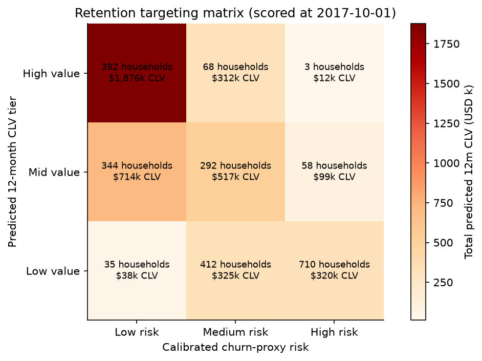
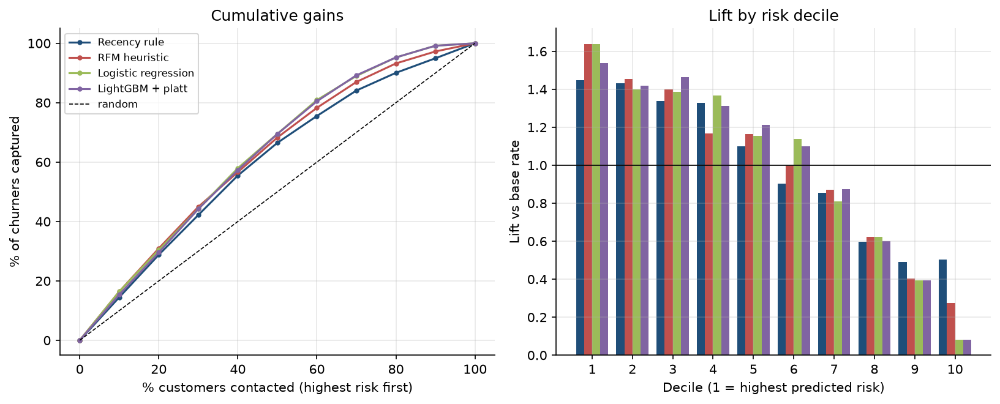
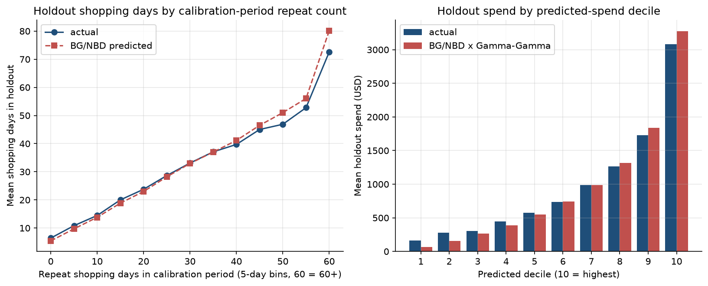
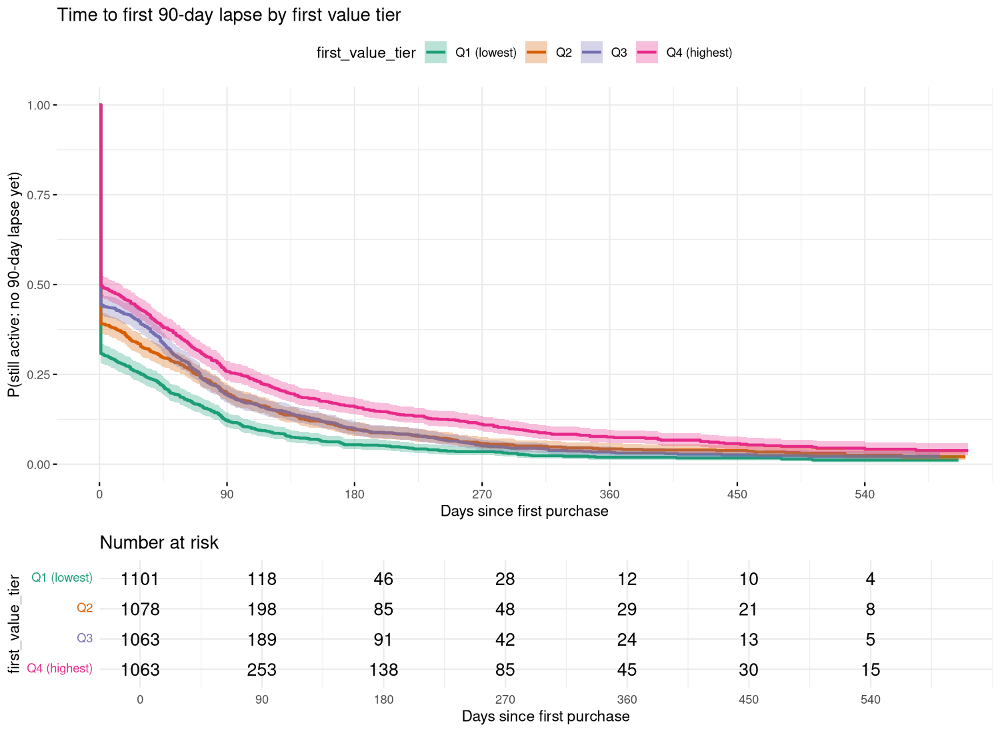
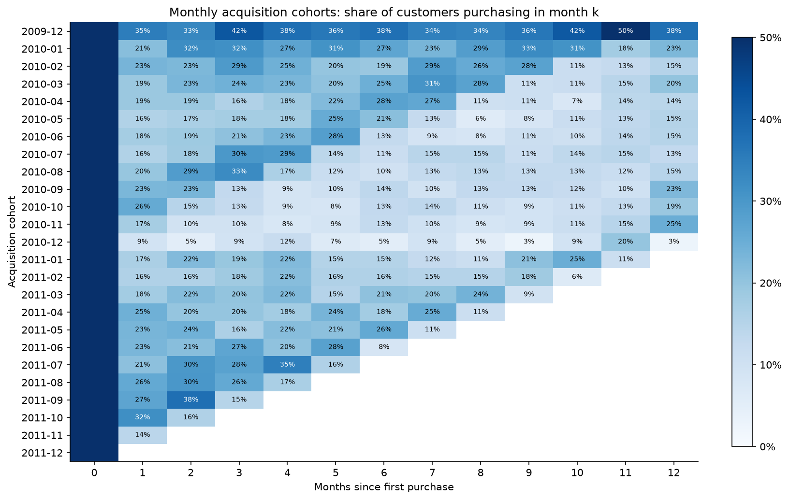
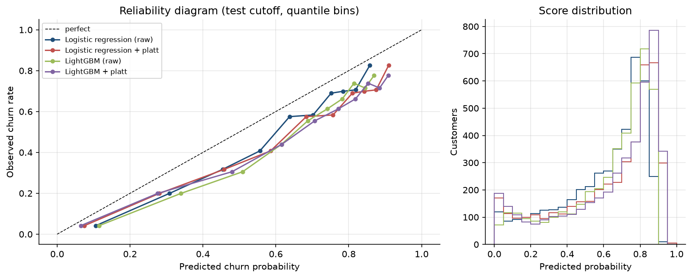
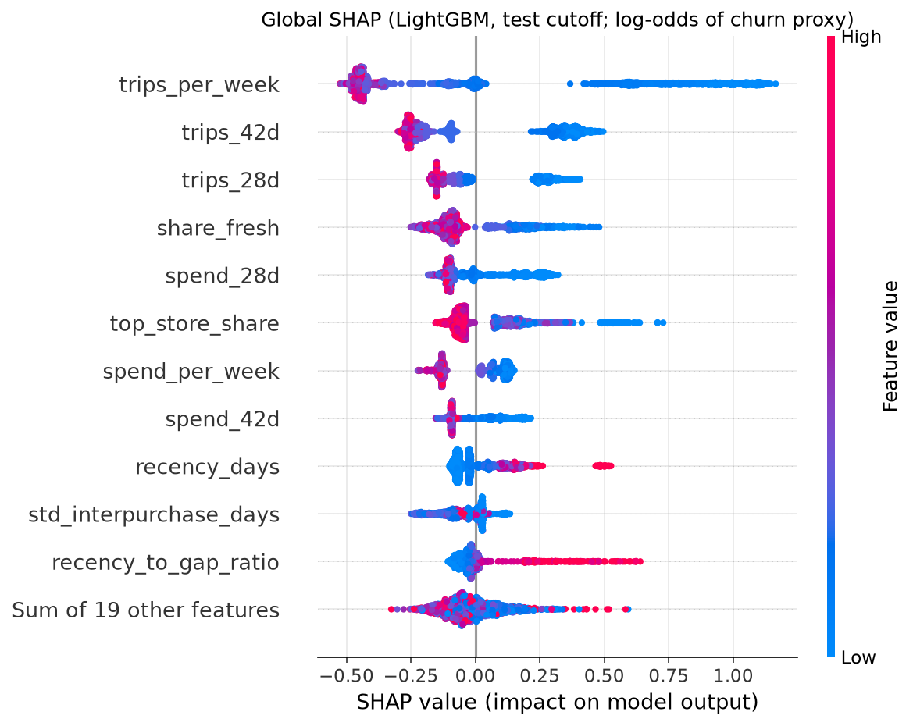
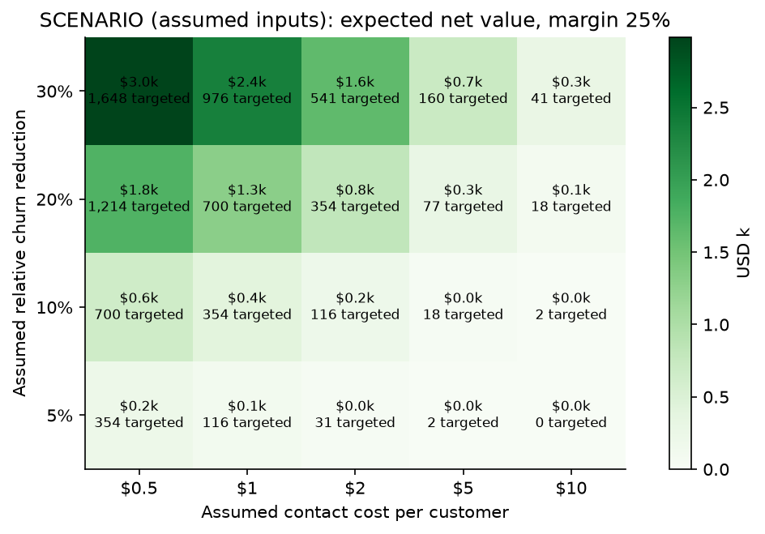

# Customer Lifecycle, Churn & Customer Lifetime Value

> **Outcome:** a reproducible pipeline that ranks 4,323 active wholesale customers by 90-day churn risk
> (ROC-AUC 0.769 out-of-time, top-decile lift 1.64x) and by predicted 12-month value (BG/NBD + Gamma-Gamma
> forecast holdout purchases within 1%), and turns both into a value x risk targeting rule whose
> economics are shown as an explicit, assumption-driven sensitivity range - not a promised impact.

[](.github/workflows/ci.yml)
· SQL (DuckDB) · Python (scikit-learn, LightGBM, SHAP, lifetimes) · R (survival, survminer, Quarto)

| | |
|---|---|
|  |  |
|  |  |

**Deliverables:** [executive memo (PDF)](docs/retention_memo.pdf) · [memo (md)](docs/retention_memo.md) ·
[survival report (HTML)](reports/survival_report.html) · [EDA notebook](notebooks/01_eda.ipynb) ·
[model notebook](notebooks/02_model_walkthrough.ipynb) · [data dictionary](docs/data_dictionary.md) ·
[data model](docs/data_model.md) · [architecture](docs/architecture.md)

---

## 1. Situation & question
A UK online gift wholesaler sells mostly to small retailers. There is no subscription, so customers never
"cancel" - they just stop ordering. Commercial leadership asks:

> **Which customers should receive retention spend, and how much might their future purchases be worth?**

This is answered with three complementary lenses: a **churn-proxy classifier** (who is at risk in the next
90 days), a **probabilistic CLV model** (what their future purchases are worth), and **survival analysis**
(when customers lapse and what at acquisition predicts it).

## 2. Data
| | |
|---|---|
| Source | [UCI Online Retail II](https://archive.ics.uci.edu/dataset/502/online+retail+ii) (CC BY 4.0) - see [data/README.md](data/README.md) |
| Period | 2009-12-01 to 2011-12-09 (two Excel sheets, concatenated) |
| Raw size | 1,067,371 invoice lines, 53,628 invoice numbers, 5,942 customer IDs |
| Clean grain | `fct_invoices`: one row per customer x purchase invoice - **36,592 invoices, 5,852 customers, GBP 16.82m revenue** (plus 17,584 cancellation lines worth GBP 464k kept separately as returns) |
| Customer mix | 41 countries, 91% UK; 28% bought only once; top 10% of customers = 63.4% of revenue |

**Cleaning decisions** (`sql/02`, `sql/03`; counts from `dq_report`):

| Issue | Raw lines | Decision |
|---|---|---|
| Missing Customer ID | 243,007 | excluded - cannot be attributed to a lifecycle |
| Exact duplicate lines (sheets overlap + repeats) | 34,335 | deduplicated (`ROW_NUMBER()`) |
| Cancellations (`C` invoices) | 19,494 | kept as `fct_returns` (return features), never counted as purchases |
| Negative qty on non-cancelled invoices (stock adjustments) | 3,457 | excluded |
| Price <= 0 | 6,207 | excluded |
| Non-product codes (POST, DOT, M, BANK CHARGES, AMAZONFEE, ...) | 5,834 | excluded (list in `config/config.yaml`) |
| abs(quantity) > 10,000 (e.g. the 80,995-unit order) | 11 | excluded as data-entry outliers |
| `A` bad-debt adjustments | 6 | excluded |

**Caveats:** wholesale buyers (bulk, irregular orders); only two years so each season appears at most twice;
customers first seen in Dec-2009 may be existing customers (left-truncation); Q4 is the peak season.

## 3. SQL model (DuckDB, ANSI/Postgres-friendly)
Numbered, idempotent scripts run in order by `churn sql`:

| Script | Output |
|---|---|
| `01_stage_raw.sql` | typed staging table |
| `02_data_quality.sql` | `dq_report` (one row per check) |
| `03_clean_transactions.sql` | `fct_lines`, `dq_cleaning_waterfall` |
| `04_invoices.sql` | `fct_invoices`, `fct_returns`, `dim_customers` |
| `05_cohorts.sql` | monthly acquisition cohorts, `cohort_retention` matrix |
| `06_rolling_activity.sql` | rolling 30/60/90-day activity (`RANGE ... INTERVAL` frames), `monthly_active_customers` |
| `07_rfm.sql` | RFM quintiles (`NTILE`) + segments |
| `08_survival.sql` | time-to-first-90-day-lapse dataset (`LEAD` gaps) for R |

Example - rolling activity with window frames:
```sql
SELECT customer_id, invoice_date,
       SUM(n_invoices) OVER w90 AS invoices_90d,
       SUM(revenue)    OVER w90 AS revenue_90d,
       invoice_date - LAG(invoice_date) OVER (PARTITION BY customer_id ORDER BY invoice_date) AS days_since_prev
FROM daily
WINDOW w90 AS (PARTITION BY customer_id ORDER BY invoice_date
               RANGE BETWEEN INTERVAL 89 DAY PRECEDING AND CURRENT ROW);
```
Example - point-in-time label (in `src/churn_clv/features.py`):
```sql
-- features: invoice_date <  cutoff          label: cutoff <= invoice_date < cutoff + 90
CASE WHEN f.customer_id IS NULL THEN 1 ELSE 0 END AS churned   -- churn PROXY
```


Month-1 retention averages 21.0% across cohorts.

## 4. Modelling (Python) and validation (R)
**Churn proxy.** `churned = 1` if a customer active in the prior 365 days places **no invoice in the 90 days
after the cutoff**. This is a *behavioural proxy* for churn, not an observed cancellation.

**Features** (19, all computed strictly before the cutoff): recency, tenure, frequency, monetary, AOV,
30/90/180-day invoice and revenue windows, active months in last 12, inter-purchase gap mean/std,
recency-to-gap ratio, product breadth, returns count/ratio, UK flag ([dictionary](docs/data_dictionary.md)).

**Models:** recency-rule baseline, RFM-score baseline, logistic regression (log + standardise), LightGBM
(4-config grid chosen on validation). Calibration: Platt vs isotonic chosen by 5-fold cross-fitted Brier on
the validation snapshot. The final model is the ML model with the best **validation** PR-AUC.

**CLV:** BG/NBD (purchase frequency, daily periods) + Gamma-Gamma (spend) with `lifetimes`, validated on a
calibration (to 2011-06-01) / 191-day holdout split; 12-month discounted CLV (1%/month) scored at the
test cutoff using only pre-cutoff data.

**R survival layer** ([report](reports/survival_report.html), `R/survival_analysis.R`): Kaplan-Meier time to
first 90-day lapse, log-rank tests by first-order value tier, country and acquisition quarter, Cox PH with
`cox.zph` checks and a stratified remedy. Covariates are fixed at acquisition to avoid immortal-time bias.

## 5. Validation design, baselines, metrics, sensitivity
```
train cutoffs: 2010-06-01, 2010-09-01, 2010-12-01, 2011-03-01  (14,482 customer-snapshots)
validation:    2011-06-01  (tuning + calibration, 4,324 customers)
test:          2011-09-01  (reported once, 4,323 customers)
```
Each label window closes before the next split's cutoff. A rolling-origin backtest retrains at four
evaluation cutoffs. `tests/test_features_leakage.py` proves features are byte-identical when every
post-cutoff row is altered or dropped.

## 6. Results (all computed by `make all`)
**Churn-proxy rate:** 56.9% train (ranging 41.7%-66.8% by cutoff), 63.4% validation, **50.5% test**.

**Test cutoff (2011-09-01), out-of-time:**

| Model | ROC-AUC | PR-AUC | Brier | ECE | Lift top 10% | Churners captured in top 30% |
|---|---|---|---|---|---|---|
| Recency rule | 0.706 | 0.670 | 0.235 | 0.135 | 1.45x | 42.2% |
| RFM heuristic | 0.750 | 0.715 | 0.204 | 0.044 | 1.64x | 44.9% |
| Logistic regression (raw) | **0.769** | **0.737** | **0.202** | 0.093 | **1.64x** | 44.2% |
| **Logistic regression + Platt** (final) | 0.769 | 0.737 | 0.209 | 0.123 | 1.64x | 44.2% |
| LightGBM (raw) | 0.765 | 0.725 | 0.211 | 0.127 | 1.52x | 44.4% |
| LightGBM + Platt | 0.765 | 0.725 | 0.214 | 0.133 | 1.52x | 44.4% |

**Rolling backtest ROC-AUC** (LogReg / LightGBM / RFM / Recency): 2010-12: 0.789 / 0.783 / 0.774 / 0.701 ·
2011-03: 0.776 / 0.762 / 0.771 / 0.712 · 2011-06: 0.809 / 0.805 / 0.785 / 0.743 · 2011-09: 0.769 / 0.768 /
0.752 / 0.706. Logistic regression is best at every cutoff; LightGBM adds nothing over a well-specified linear model
on 19 aggregated features. The lift over RFM is consistent but modest (+0.005 to +0.024 ROC-AUC).

**Calibration - the honest finding.** Platt scaling was chosen on validation (CV Brier 0.1640 vs isotonic
0.1650) and is well calibrated there, but at the September test cutoff every model **over-predicts churn**:
mean predicted 62.8% vs observed 50.5% for the final model. The Sep-Nov label window is peak season, so
churn is structurally lower; post-hoc calibration on June made it slightly worse (Brier 0.202 -> 0.209). A
same-season prior adjustment was considered and rejected because it failed on the validation cutoff. Use scores
to **rank**; re-calibrate on the latest comparable season before reading them as probabilities.


**Top SHAP drivers** (LightGBM, mean |SHAP|, log-odds): active months in last 12 (0.31), invoices in last
180 days (0.19), revenue in last 180 days (0.18), mean inter-purchase gap (0.16), tenure (0.14),
recency-to-gap ratio (0.09). Logistic-regression SHAP is dominated by monetary total and frequency with
opposing signs (correlated features), so the tree SHAP is the cleaner global view.


**CLV holdout validation (191 days, 4,912 customers):** predicted 8,003 vs actual 8,065 repeat purchases
(-0.8%); per-customer correlation 0.85, MAE 1.08 purchases. Spend: predicted GBP 3.97m vs actual GBP 4.52m
(-12%; under-forecast concentrated in the top decile; the holdout contains the Q4 peak and BG/NBD has no
seasonality); Pearson 0.92, Spearman 0.59. The top 10% by predicted spend delivered 63.7% of actual holdout spend.
Gamma-Gamma fitted q = 0.89 < 1 (very heavy-tailed spend), so the population-mean AOV is undefined; zero-repeat
customers get the pooled empirical repeat AOV instead (documented in `clv.py`).

**Targeting matrix at 2011-09-01** (risk = tertiles of calibrated churn probability; value = CLV
<50% / 50-80% / top 20%), with *observed* next-90-day churn:

| Value \ Risk | Low | Medium | High |
|---|---|---|---|
| High | 794 (GBP 4.50m CLV, observed churn 12%) | 64 (GBP 157k, 48%) | 7 (GBP 14k, 43%) |
| Mid | 547 (GBP 583k, 28%) | 633 (GBP 592k, 52%) | 116 (GBP 86k, 66%) |
| Low | 100 (GBP 42k, 43%) | 744 (GBP 257k, 62%) | 1,318 (GBP 386k, 75%) |

**ROI rule (ASSUMED parameters):** contact if `P(churn) x uplift x CLV12m x margin > cost`. Base case
(**assumed** 10% relative churn reduction, 30% margin, GBP 5/contact) targets 3,657 customers (85%) at
GBP 18.3k for an expected GBP 35.5k net. Over the 48-scenario grid (uplift 5-30%, margin 20-40%, cost GBP 1-20)
the targeted count ranges 32-4,311 and expected net value GBP 0.3k-219k. **These are scenario
calculations, not measured impact,** and they inherit the over-predicted churn probabilities.


**Survival (R; 4,305 customers acquired 2010-01 onwards, 92.8% with an observed lapse):**
* Only **40.9%** of new customers return within 90 days of their first order; 19.2% are still lapse-free at day
  90 and 4.1% at day 365 (KM).
* Log-rank: first-order value tier chi2 = 92.8 (p = 5.5e-20); acquisition quarter chi2 = 96.5 (p = 8.9e-21);
  country group chi2 = 13.8 (p = 0.008). Day-90 lapse-free share: 25.8% for the top first-order-value quartile
  vs 12.2% for the bottom.
* Cox PH (concordance 0.60): HR 0.88 per log-unit of first-order value (95% CI 0.84-0.92), HR 0.92 per
  log-unit of first-order product count; Q4 acquisitions lapse faster (HR 1.51 vs Q1).
* `cox.zph`: acquisition quarter violates PH (p = 0.001; global p = 0.035). Stratifying on quarter fixes it
  (global p = 0.83) with unchanged HRs (first-order value HR 0.88). Including the left-truncated Dec-2009 cohort
  moves the value HR to 0.83.

## 7. Recommended actions, trade-offs, limitations
1. **Protect the 794 High-value / Low-risk customers** (68% of predicted CLV and 68% of next-quarter revenue)
   with service, not discounts - discounting customers who would stay anyway wastes margin.
2. **Personal outreach to the 71 High-value / Medium-High-risk customers** and **automated win-back for the 749
   Mid-value at-risk customers** - with a randomised control group so uplift is *measured*.
3. **Fix activation:** 59% of new customers lapse right after their first order; a second-order programme
   tested on new customers targets the biggest leak.
4. **Re-calibrate seasonally** and re-score monthly (`churn score --cutoff YYYY-MM-DD`).

*Trade-offs:* logistic regression was chosen over LightGBM for accuracy and interpretability; tertile risk
bands are relative (stable under seasonal drift) but hide absolute-level shifts; the ROI rule is only as good
as the uplift assumption. *Limitations:* churn is a proxy; no marketing/treatment data, so no causal uplift;
one wholesaler, two years, 91% UK; missing-ID lines (23% of raw) excluded; CLV has no seasonality.

## 8. How to run on a clean machine
Requirements: Python 3.11, (optional) R >= 4.3 with `survival survminer dplyr readr ggplot2 knitr rmarkdown`
(versions in `renv.lock`), Quarto >= 1.4 for HTML.
```bash
git clone <repo> && cd customer-churn-clv
make setup          # venv + pinned requirements.txt + editable package
make data           # download UCI zip, xlsx -> parquet       (~1-2 min)
make sql            # DuckDB SQL model                          (~10 s)
make train          # churn models, calibration, SHAP, CLV, targeting (~30 s)
make report         # R survival (Quarto HTML or Rscript), memo PDF, executed notebooks
make test           # ruff + pytest
make app            # optional Streamlit explorer
# or: make all
churn score --cutoff 2011-12-10   # score any date with the saved calibrated model
```
In R: `Rscript -e 'renv::restore()'` restores package versions. CI (`.github/workflows/ci.yml`) runs ruff and
the full pytest suite on synthetic + edge-case fixtures (no raw data needed).

```
├── config/config.yaml        all parameters (cutoffs, horizon, codes, ASSUMED targeting inputs)
├── sql/01..08_*.sql          DuckDB SQL model
├── src/churn_clv/            package + `churn` CLI
├── R/ , reports/             survival analysis (Rscript + Quarto report)
├── notebooks/                executed EDA + model walkthrough
├── tests/                    unit, data-contract, leakage, metric-regression tests
├── docs/                     memo, dictionary, ER + pipeline diagrams, figures
├── artifacts/                aggregated metrics (json/csv); customer-level files git-ignored
└── app/streamlit_app.py      score/segment explorer
```
MIT licensed. Dataset: Chen, D. (2012), UCI ML Repository, CC BY 4.0.
