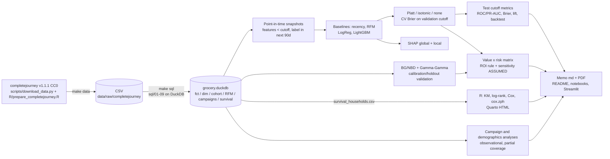

# Architecture and pipeline



## Time-aware validation design

```mermaid
gantt
    dateFormat  YYYY-MM-DD
    axisFormat  %Y-%m
    title Snapshot cutoffs (features before cutoff | 90-day label window after)
    section Train
    2017-02-12 label :a1, 2017-02-12, 90d
    2017-02-26 label :a2, 2017-02-26, 90d
    2017-03-12 label :a3, 2017-03-12, 90d
    2017-03-26 label :a4, 2017-03-26, 90d
    section Validate (tuning + calibration)
    2017-07-02 label :b1, 2017-07-02, 90d
    section Test (reported)
    2017-10-01 label :c1, 2017-10-01, 90d
    section CLV holdout
    calibration to 2017-07-02, holdout to 2017-12-31 :d1, 2017-07-02, 2017-12-31
```

Every training label window closes before the validation cutoff, and the validation window closes before the
test cutoff, so no training label overlaps validation or test outcomes (`features.validate_split_design`
enforces this). A rolling-origin backtest (`artifacts/backtest_metrics.csv`) retrains at each of five evaluation
cutoffs using only snapshots whose label windows had closed. With 12 months of data the whole design sits
inside one year, so model inputs are rates, shares and fixed windows only (see the README design notes).

## Code map
| Path | Role |
|---|---|
| `sql/` | numbered, idempotent DuckDB SQL (CTEs and window functions) |
| `scripts/download_data.py`, `R/prepare_completejourney.R` | fetch the CC0 data and convert it to CSV |
| `src/churn_clv/db.py` | registers inputs and parameters, runs SQL in order, exports tables |
| `src/churn_clv/features.py` | point-in-time features, churn-proxy label, split-design validation |
| `src/churn_clv/models.py` | baselines, logistic regression, LightGBM, calibrators (Platt, isotonic, none) |
| `src/churn_clv/metrics.py` | ROC/PR-AUC, Brier, ECE, calibration slope, lift/gains, bootstrap CIs |
| `src/churn_clv/clv.py` | BG/NBD + Gamma-Gamma, holdout validation, discounted CLV |
| `src/churn_clv/targeting.py` | value x risk segments, expected-value rule, ASSUMED sensitivity grid |
| `src/churn_clv/campaigns.py`, `demographics.py` | observational campaign analysis, partial-coverage breakout |
| `src/churn_clv/pipeline.py`, `cli.py` | orchestration and the `churn` CLI |
| `R/survival_analysis.R`, `reports/survival_report.qmd` | landmark survival analysis and Quarto report |
| `scripts/build_memo.py` | memo generated from artifacts only |
| `scripts/export_app_data.py` | compact `app/data` for the Streamlit app |
| `app/streamlit_app.py`, `app/views/` | multipage explorer (reads `app/data` only) |
