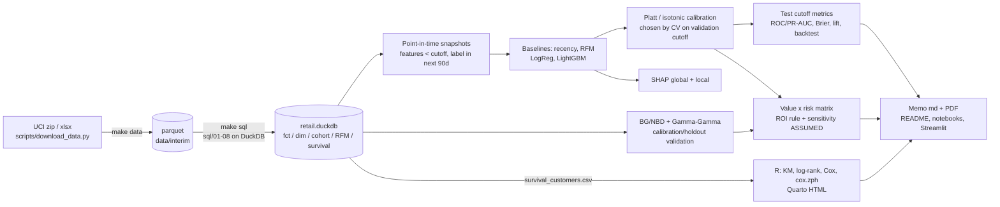

# Architecture & pipeline



## Time-aware validation design

```mermaid
gantt
    dateFormat  YYYY-MM-DD
    axisFormat  %Y-%m
    title Snapshot cutoffs (features before cutoff | 90-day label window after)
    section Train
    2010-06-01 label :a1, 2010-06-01, 90d
    2010-09-01 label :a2, 2010-09-01, 90d
    2010-12-01 label :a3, 2010-12-01, 90d
    2011-03-01 label :a4, 2011-03-01, 90d
    section Validate (tuning + calibration)
    2011-06-01 label :b1, 2011-06-01, 90d
    section Test (reported)
    2011-09-01 label :c1, 2011-09-01, 90d
    section CLV holdout
    calibration to 2011-06-01, holdout to 2011-12-09 :d1, 2011-06-01, 2011-12-09
```

Every label window ends before the next split's cutoff, so no training label overlaps validation or test
outcomes. A rolling-origin backtest (`artifacts/backtest_metrics.csv`) re-trains at each evaluation cutoff
using only snapshots whose label windows closed before it.

## Code map
| Path | Role |
|---|---|
| `sql/` | numbered, idempotent DuckDB SQL (ANSI/Postgres-friendly CTEs + window functions) |
| `src/churn_clv/db.py` | registers inputs/params, runs SQL in order, exports tables |
| `src/churn_clv/features.py` | point-in-time feature + churn-proxy label SQL |
| `src/churn_clv/models.py` | baselines, logistic regression, LightGBM, calibrators |
| `src/churn_clv/metrics.py` | ROC/PR-AUC, Brier, ECE, lift/gains |
| `src/churn_clv/clv.py` | BG/NBD + Gamma-Gamma, holdout validation, discounted CLV |
| `src/churn_clv/targeting.py` | segments, expected-value rule, sensitivity grid |
| `src/churn_clv/pipeline.py` / `cli.py` | orchestration and `churn` CLI |
| `R/survival_analysis.R`, `reports/survival_report.qmd` | survival analysis |
| `scripts/build_memo.py` | memo generated from artifacts only |
| `app/streamlit_app.py` | interactive explorer |
