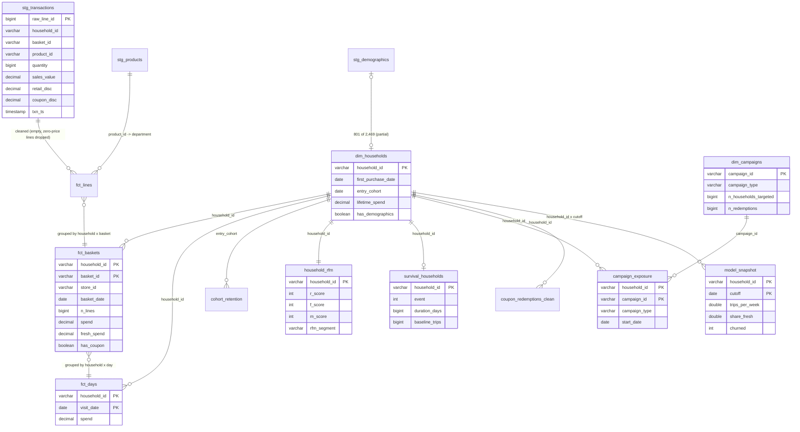

# Entity / data model

`model_snapshot` is produced in Python (`features.build_snapshot`) from `fct_baskets`, `fct_days`,
`campaign_exposure` and `coupon_redemptions_clean`, one cutoff at a time. `fct_returns` exists but is empty
because the extract has no negative quantities or sales values.
