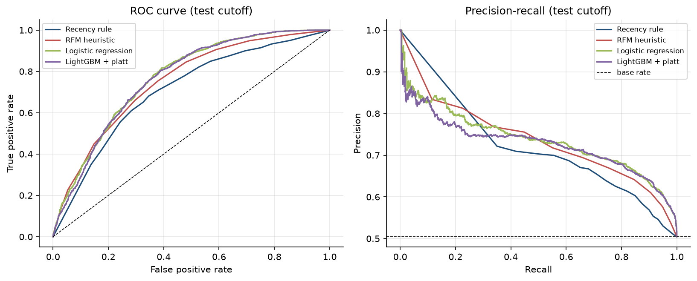

# Retention Strategy Memo - Online Retail II

**To:** Commercial leadership | **From:** Customer Analytics | **Scoring date:** 2011-09-01 (back-test)
**Basis:** UCI Online Retail II, 2009-12-01 to 2011-12-09; every figure below is computed by the
pipeline in this repository. Items marked **ASSUMED** are scenario inputs, not observed results.

## 1. The decision
Which active customers should receive retention spend in the next quarter, and how much is their future
purchasing plausibly worth?

## 2. What the data says (observed)
* **5,852 identifiable customers** placed 36,592 clean invoices worth
  GBP 16.82m. 28% bought only once.
* **Activation is the biggest leak.** Only 41% of new customers made a repeat purchase
  within 90 days of their first order; 4.1% were still active without any 90-day lapse
  after a year (Kaplan-Meier). Customers whose first order was in the top value quartile stayed active at
  90 days at 26% vs 12% for the bottom quartile; each 1-unit increase in log first-order value cuts the
  lapse hazard by 12% (stratified Cox HR 0.88, 95% CI 0.84-0.92).
* **Churn proxy** (no purchase in the 90 days after the scoring date - a behavioural proxy, not a cancellation):
  50.5% of the 4,323 customers active in the prior year at 2011-09-01.

 

## 3. How well can we predict it (out-of-time test, 2011-09-01)
| Approach | ROC-AUC | PR-AUC | Lift, top 10% |
|---|---|---|---|
| Recency rule (baseline) | 0.706 | 0.670 | 1.45x |
| RFM heuristic (baseline) | 0.750 | 0.715 | 1.64x |
| **Logistic regression + platt** (selected on validation) | **0.769** | **0.737** | **1.64x** |

The model ranks risk better than the baselines, but the gain over a simple RFM score is modest
(+0.019 ROC-AUC). **Calibration caveat:** at this pre-Christmas scoring date the model
predicted an average churn risk of 63% versus 50% observed, consistent with
seasonal Q4 demand lowering churn (training windows mix seasons). Use the scores to *rank* customers; re-calibrate on the latest season before using
them as absolute probabilities.

**Value forecast (BG/NBD + Gamma-Gamma):** on a 191-day holdout the model predicted
8,003 repeat purchases vs 8,065 actual and
GBP 3.97m spend vs GBP 4.52m actual (spend under-forecast by
12%; the holdout contains the Q4 peak and the model has no
seasonality). The top 10% of customers by
predicted value delivered 64% of actual holdout spend.

## 4. Value x risk segments at 2011-09-01
* **Protect - High value / Low risk:** 794 customers, GBP 4.50m predicted 12-month
  CLV (68% of the total). Observed next-90-day churn was only
  12% and they generated 68% of next-quarter revenue.
  Service, not discounts.
* **Save - High value at Medium/High risk:** 71 customers, GBP 172k
  CLV; observed churn 48%.
  Highest priority for personal outreach.
* **Grow - Mid value at Medium/High risk:** 749 customers, GBP 677k
  CLV (Mid/Medium alone: 633). Low-cost automated win-back.
* **Low value / High risk:** 1,318 customers, mean CLV GBP 293:
  email-only or no spend.

## 5. Recommended targeting rule (scenario - ASSUMED inputs)
Contact a customer when *P(churn) x uplift x CLV(12m) x margin > contact cost*.
With **ASSUMED** 10% relative churn reduction, 30% margin and GBP 5
per contact, the rule selects 3,657 customers (85%), costing
GBP 18k with an expected net value of GBP 35k. Under a conservative
scenario (5% uplift, GBP 10 contact) it selects 690
customers for GBP 3,906. Across the 48-scenario grid the expected net value ranges
from GBP 325 to GBP 219k. **These are not
observed impacts**; the probabilities feeding them are over-stated at this date (section 3).

## 6. Next steps
1. Run a randomised hold-out test (e.g. 20% control) in the Save and Grow cells to *measure* uplift; replace the
   assumption with the measured value.
2. Launch a second-order activation programme for new customers (the day-1 lapse is the largest loss).
3. Re-score monthly with `churn score --cutoff <date>` and re-calibrate on the most recent comparable season.

*Limitations: wholesale-heavy, 91% UK customer base; 2 years of history (one Q4 per
split); 243,007 raw lines lacked a customer ID and are excluded; churn is a proxy.*
