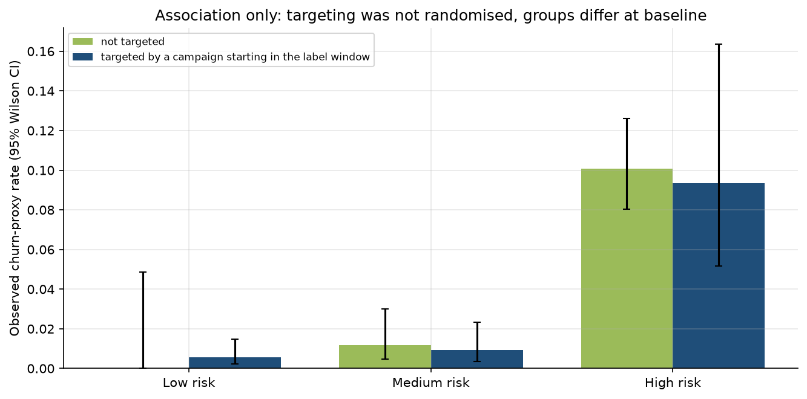

# Retention Strategy Memo - US Grocery Loyalty Panel

**To:** Commercial leadership | **From:** Customer Analytics | **Scoring date:** 2017-10-01 (back-test)
**Basis:** Complete Journey 2.0 (84.51, CC0), 2,469 loyalty-card households, 2017-01-01 to
2017-12-31. Every figure is computed by the pipeline in this repository. Items marked **ASSUMED** are
scenario inputs, not observed results. **Churn is a proxy**: no purchase in the 90 days after the
cutoff, not an observed cancellation.

## 1. The decision
Which active households should receive retention spend (coupons, outreach) next quarter, and how much is their
future spend plausibly worth?

## 2. What the data says (observed)
* 2,469 households made 155,368 clean baskets worth $4.60M across
  457 stores. The top 10% of households account for 35% of spend.
* Store discounts are 14.7% of shelf value and coupon discounts only
  0.57%; 6.3% of baskets use a coupon.
* Households rarely go quiet: 93.4% remain lapse-free at day 90 (Kaplan-Meier, landmark
  design). Baseline trip frequency separates them sharply: day-90 survival is 86.8% for the lowest
  trip tier and 99.7% for the highest (Cox hazard ratio per log trip 0.25, 95% CI
  0.19 to 0.34; the proportional-hazards test flags this effect as time-varying).

## 3. Churn-proxy model (out-of-time test, 2,314 households, 89 positives)
* Prevalence is 3.8% (train 3.3%, validation
  4.4%).
* Test ROC-AUC with 95% bootstrap intervals: recency rule 0.793 (0.741 to
  0.847), RFM heuristic 0.806, logistic regression 0.841
  (0.803 to 0.875), LightGBM
  0.843 (0.804 to 0.878).
  PR-AUC: 0.144, 0.123, 0.152, 0.161 against a 0.038 base rate.
* **LightGBM is not distinguishable from logistic regression**: paired-bootstrap ROC-AUC difference +0.002
  (-0.012 to +0.017). Logistic regression beats the RFM heuristic by +0.034
  (+0.015 to +0.055). In the rolling backtest LightGBM matches or beats logistic regression at
  5 of 5 cutoffs.
* Final model: LightGBM + platt (best validation PR-AUC); top-decile lift 4.03x. **Calibration did not improve
  Brier on test**: raw LightGBM 0.0345, final 0.0355. Mean predicted risk is
  3.1% raw and 4.4% after Platt scaling versus
  3.8% observed; calibration slope 0.78. Isotonic was ineligible with
  100 validation positives. Use scores for ranking.
* Main drivers (mean |SHAP|): trips per week, trips 42d, trips 28d, share fresh.

## 4. Lifetime value (BG/NBD + Gamma-Gamma, 182-day holdout)
Predicted holdout shopping days are 64,059 versus 63,212 actual
(+1.3%); spend $2.30M versus
$2.29M (+0.1%). Household-level MAE is
8.82 shopping days against 8.96 for a naive carried-forward rate: the model is
right in aggregate and for ranking (Spearman 0.81), but only slightly better per household.

## 5. Coupons and campaigns (observational, no causal claim)
* 27 campaigns reached 1,559 households; 410
  redeemed at least one coupon. Type A campaigns reach about 1,076 households each
  and have a 16.6% redeeming share of targeted, versus
  6.5% for Type B.
* Households targeted in the test window churn less (naive gap -5.1 points), but within
  model risk tiers the gap is -0.1 points: targeting reached heavier shoppers
  (largest baseline standardised difference 1.42). There is no holdout, so the data
  cannot say whether campaigns work.

## 6. Value x risk targeting (ASSUMED ROI)
* 392 High value / Low risk households hold 45% of predicted
  CLV (observed churn 0.5%): protect with service, not discounts. Only
  71 households are both high value and at elevated risk.
* Most risk sits in Low value households (710 High risk, observed churn
  10.7%).
* **ASSUMED** 10% relative churn reduction, 25% margin,
  $2.00 per contact: the rule targets 116 households
  (5.0%) for expected net value $190 on
  $232 of cost; contacting everyone would be -$3,278.
  Across the ASSUMED sensitivity grid net value ranges from $0 to
  $4,545. These are scenarios, not forecasts.

## 7. Demographics (partial coverage)
Only 801 of 2,469 households (32%) have demographics. They are
heavier shoppers (median spend to date $1,981 versus
$579) and only 2 of
801 scored covered households went quiet, so group churn rates are not informative.

## 8. Recommendation and next step
Protect high-value households with service; do not spend discounts where risk is low. Before any ROI claim, run a
randomised holdout campaign stratified by risk and value tier and replace the ASSUMED uplift with a measured one.

## 9. Limitations
One calendar year, one retailer, 2,469 loyalty-card households (card-less purchases are invisible);
about 89 churn-proxy events per cutoff so model differences are within noise; the label is a
proxy; partial demographics; BG/NBD has no seasonality and 12-month CLV extrapolates beyond one observed year;
this extract contains no returns.

 
