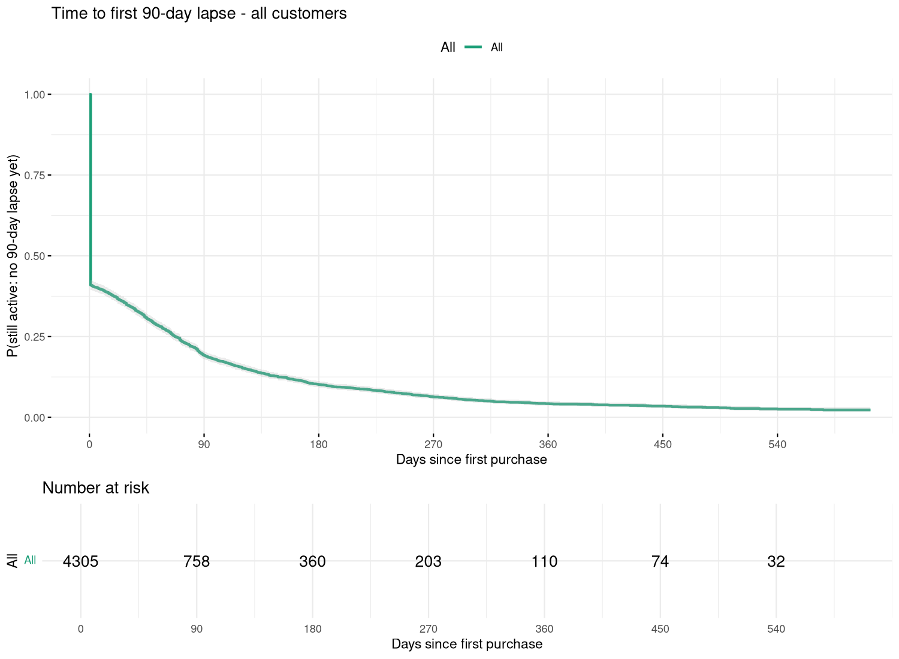
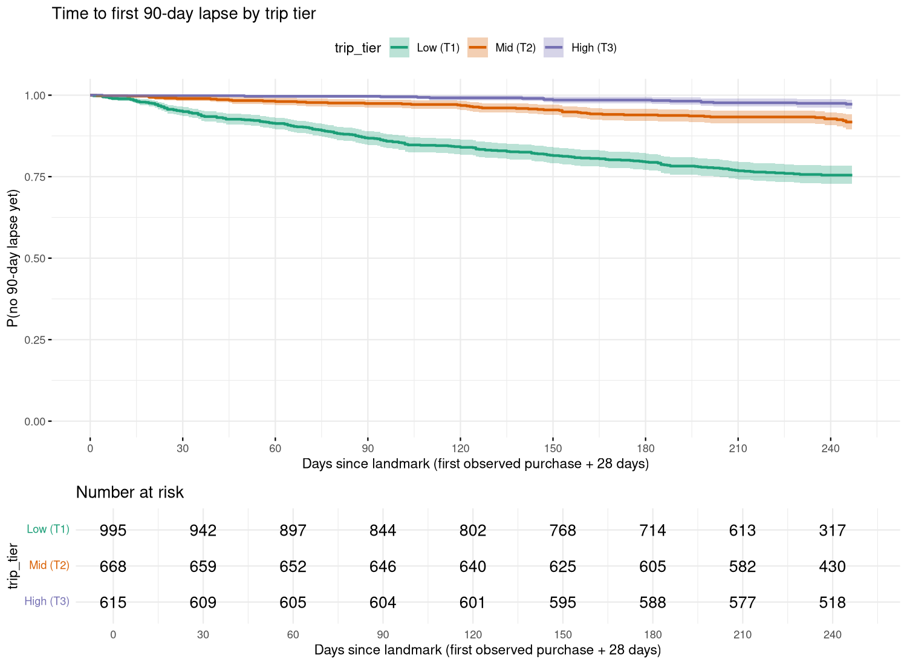
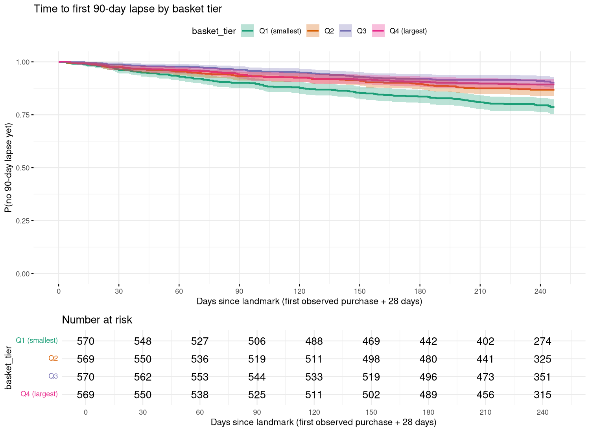
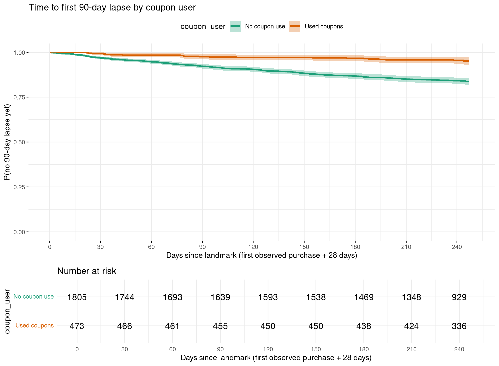
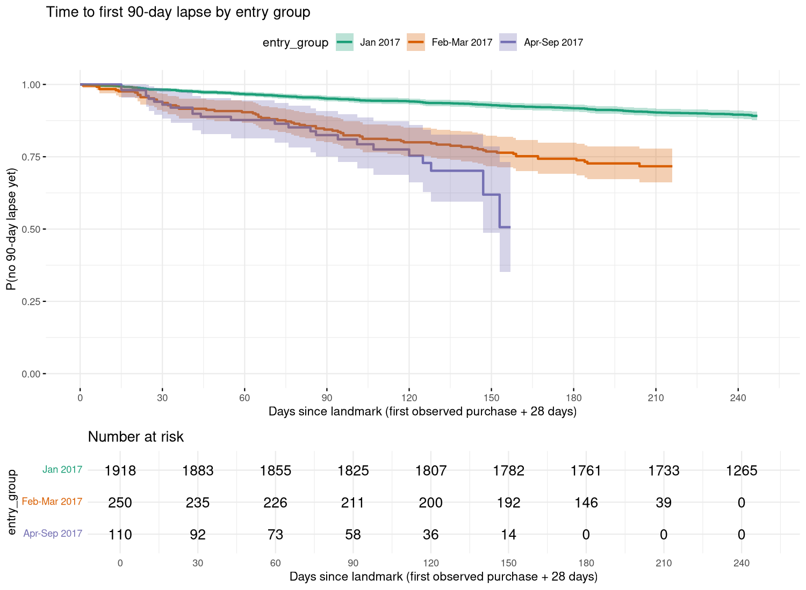
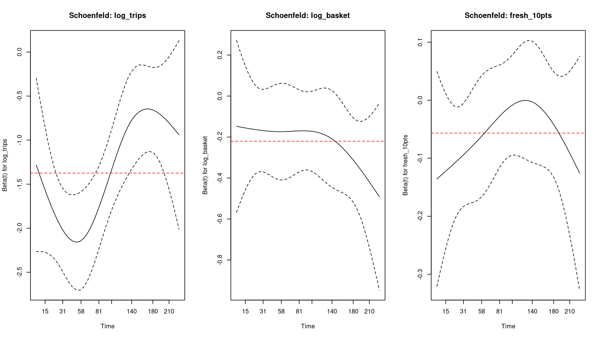

## Question, data and event definition

The Python models answer *who* is likely to be inactive in the 90 days after a cutoff. This report asks *when*
households first go quiet and which early shopping behaviours are associated with that timing.

Data: the `completejourney` CC0 sample released by 84.51 (2,469 loyalty-card households, calendar year 2017,
one retail chain). There is no subscription or cancellation record, so everything below is an **inactivity
proxy**, not observed churn.

* **Event (lapse)**: the first gap between two shopping days longer than 90 days, starting at or after the
  landmark. A lapse is only confirmable if the 90-day gap fits inside the data, so households with no
  confirmable lapse are right-censored at `data_end - 90` days.
* **Time origin**: the first *observed* purchase. The panel starts on 2017-01-01, so this is **not** acquisition:
  households that already shopped before 2017 enter at their first 2017 purchase (left-censored tenure).
* **Landmark design**: baseline covariates are measured over the 28 days after the origin and households enter
  the risk set at origin + 28 days. Covariates never use follow-up information, which avoids immortal-time bias.
* **Exclusions** (counted, not hidden): households whose landmark falls after `data_end - 90` (no time at
  risk) and households that already lapsed before the landmark.
* Everything is an observational association. Nothing here is a causal effect of coupons or basket size.

```{r run}
#| output: false
Sys.setenv(CHURN_CLV_ROOT = normalizePath(".."))
source("../R/survival_analysis.R", chdir = FALSE)
```

```{r helpers}
library(knitr)
out <- file.path(root, "artifacts", "r_survival")
rd <- function(f) readr::read_csv(file.path(out, f), show_col_types = FALSE)
```

## Overall survival

`r nrow(d)` households analysed, `r sum(d$event)` lapse events (`r round(100*mean(d$event),1)`%), maximum
follow-up `r max(d$duration_days)` days after the landmark.

```{r km-overall-table}
kable(rd("km_overall.csv"), digits = 3, caption = "Kaplan-Meier: share of households without a 90-day lapse")
```



The curve is flat compared with a subscription business: most loyalty-card households keep shopping. The
median time to lapse is not reached within the follow-up window, so we report survival at fixed horizons
instead of a median.

## Segment comparisons (log-rank)

Tiers use quantile cut points of real values, so households with the same value always share a tier:
`r grep("trip tiers", readLines(file.path(out, "summary.txt")), value = TRUE)`.

```{r logrank}
kable(rd("logrank_tests.csv"), digits = 4, caption = "Log-rank tests")
```

::: {.panel-tabset}
### Baseline trips (tertiles)

```{r}
kable(rd("km_by_trip_tier.csv"), digits = 3)
```
### Baseline basket size (quartiles)

```{r}
kable(rd("km_by_basket_tier.csv"), digits = 3)
```
### Coupon use in baseline window

```{r}
kable(rd("km_by_coupon_user.csv"), digits = 3)
```
### Entry month group

```{r}
kable(rd("km_by_entry_group.csv"), digits = 3)
```
:::

Entry month group is partly a data-window artifact: households that first appear after January are
lighter shoppers (median 2 baseline trips versus 4 for January entrants), as a household that shopped weekly would
usually have appeared in January. It is therefore used as an adjustment variable, not interpreted as a cohort effect.

## Cox proportional hazards

```{r cox}
kable(rd("cox_hazard_ratios.csv"), digits = 3, caption = "Hazard ratios (HR < 1 = slower lapse)")
```

Concordance: `r round(cs$concordance[1], 3)` (se `r round(cs$concordance[2], 3)`).

### Proportional-hazards check (`cox.zph`)

```{r zph}
kable(rd("cox_zph.csv"), digits = 4)
```



The global test rejects proportional hazards (p < 0.01): baseline trip frequency (`log_trips`) and the entry group
both show time-varying effects (see the Schoenfeld plots). The model is therefore refitted **stratified** on entry
group, which brings the global test closer to non-significance, but the `log_trips` violation remains. Its hazard
ratio should be read as an *average* effect over follow-up, not a constant one.

```{r strat}
kable(rd("cox_stratified_hazard_ratios.csv"), digits = 3, caption = "Stratified Cox (strata = entry group)")
kable(rd("cox_stratified_zph.csv"), digits = 4, caption = "Stratified cox.zph")
```

## Sensitivity and limitations

```{r sens}
cat(tail(readLines(file.path(out, "summary.txt")), 2), sep = "\n")
```

* Lapse is a behavioural proxy; a household may return after 90 or more days (the event is "first lapse",
  not permanent churn).
* One calendar year only: follow-up is at most about 8 months after the landmark and tenure before 2017 is unknown.
* Covariates are baseline-window only; the Python model uses time-varying behaviour.
* Demographics cover 801 of 2,469 households and those households are heavier shoppers, with very few lapse
  events (see the line above), so no demographic survival model is fitted.
* Results are associations, not causal effects of coupons, basket size or store pattern.

```{r session}
#| code-fold: true
sessionInfo()
```
