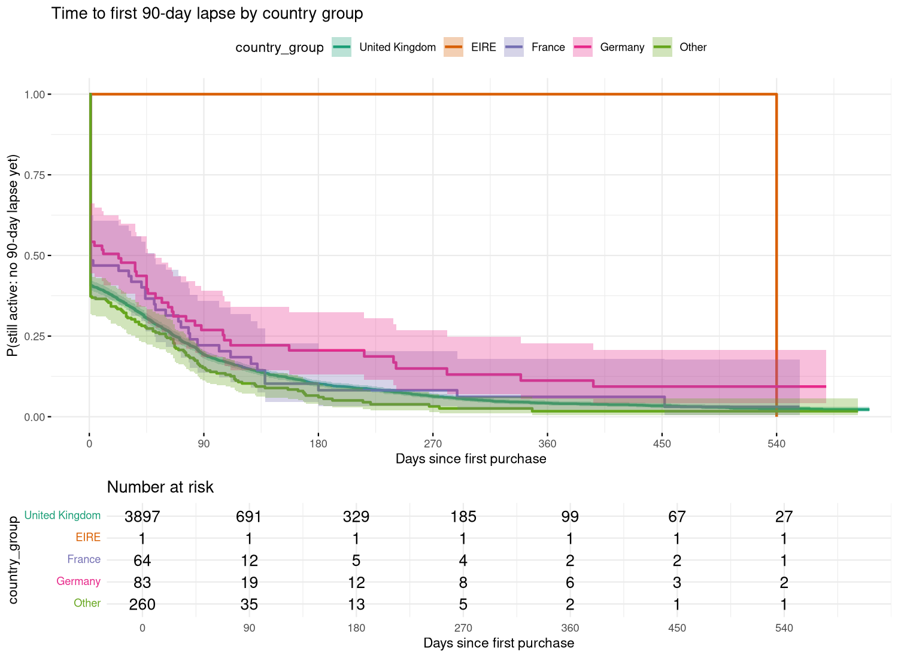
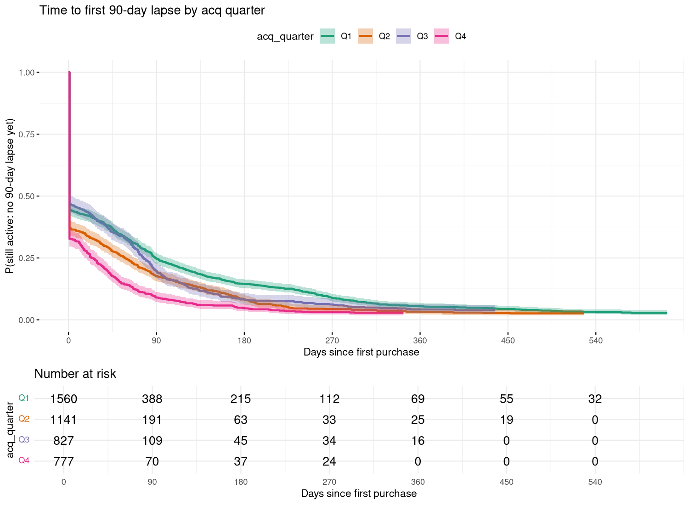

## Question and event definition

Python's churn model answers *who* is likely to lapse in the next 90 days. This report asks *when*
customers lapse after acquisition and which acquisition-time characteristics shift that timing.

* **Event (lapse)** - the first inter-purchase gap longer than 90 days (same 90-day horizon as the churn
  proxy). This is an inactivity proxy, not an observed cancellation.
* **Duration** - active days from first purchase to the last purchase before the lapse (+1 day, so a
  customer who never returns has duration 1).
* **Censoring** - customers with no observable lapse by the data end minus 90 days.
* **Covariates** are fixed at acquisition (first-order value, first-order product count, country,
  acquisition quarter). End-of-period RFM scores are deliberately *not* used: they are computed from the
  outcome period and would create immortal-time bias.
* Customers first seen in Dec-2009 are left-truncated (the extract starts then) and are excluded from the
  main analysis; a sensitivity check includes them.

```{r run}
#| output: false
Sys.setenv(CHURN_CLV_ROOT = normalizePath(".."))
source("../R/survival_analysis.R", chdir = FALSE)
```

```{r helpers}
library(knitr)
out <- file.path(root, "artifacts", "r_survival")
rd <- function(f) readr::read_csv(file.path(out, f), show_col_types = FALSE)
```

## Overall survival

`r nrow(d)` customers, `r sum(d$event)` lapse events (`r round(100*mean(d$event),1)`%).

```{r km-overall-table}
kable(rd("km_overall.csv"), digits = 3, caption = "Kaplan-Meier: share of customers without a 90-day lapse")
```


The survival curve drops by roughly 60% at day 1: most customers' *first* purchase is followed by a gap of
more than 90 days. Activation after the first order is therefore the dominant lifecycle problem.

## Segment comparisons (log-rank)

```{r logrank}
kable(rd("logrank_tests.csv"), digits = 4, caption = "Log-rank tests")
```

::: {.panel-tabset}
### First-order value tier

```{r}
kable(rd("km_by_first_value_tier.csv"), digits = 3)
```
### Country group

```{r}
kable(rd("km_by_country_group.csv"), digits = 3)
```
### Acquisition quarter

```{r}
kable(rd("km_by_acq_quarter.csv"), digits = 3)
```
:::

## Cox proportional hazards

```{r cox}
kable(rd("cox_hazard_ratios.csv"), digits = 3, caption = "Hazard ratios (HR < 1 = slower lapse)")
```

Concordance: `r round(cs$concordance[1], 3)`.

### Proportional-hazards check (`cox.zph`)

```{r zph}
kable(rd("cox_zph.csv"), digits = 4)
```


Acquisition quarter violates PH (its effect varies over follow-up time, consistent with seasonal
wholesale buying). The remedy is a Cox model **stratified** on acquisition quarter:

```{r strat}
kable(rd("cox_stratified_hazard_ratios.csv"), digits = 3)
kable(rd("cox_stratified_zph.csv"), digits = 4)
```

## Sensitivity and limitations

```{r sens}
cat(tail(readLines(file.path(out, "summary.txt")), 1))
```

* Lapse is a behavioural proxy; a customer may return after 90+ days (the event is "first lapse", not
  permanent churn).
* Covariates are acquisition-time only; the Python model covers time-varying behaviour.
* Results are associations, not causal effects of order size.

```{r session}
#| code-fold: true
sessionInfo()
```
